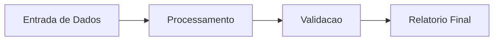

<!--
  TEMPLATE: RELATÓRIO TÉCNICO-ACADÊMICO / ESTÁGIO / ATIVIDADE PRÁTICA (UNIFIL)
  Suporta diagramas Mermaid vetoriais offline, blocos de codigo e tabelas IBGE.
  Gerar PDF com: uv run render.py relatorio-estagio-pratica.md
-->

# CAPA

**{NOME COMPLETO DO ALUNO}**

**{RELATÓRIO DE ATIVIDADE PRÁTICA / ESTÁGIO SUPERVISIONADO}: {SUBTÍTULO}**

Londrina  
2026

---

# FOLHA DE ROSTO

**{NOME COMPLETO DO ALUNO}**

**{RELATÓRIO DE ATIVIDADE PRÁTICA / ESTÁGIO SUPERVISIONADO}: {SUBTÍTULO}**

> Relatório técnico-acadêmico apresentado ao Curso de Ciência da Computação do Centro Universitário Filadélfia (UniFil), referente às atividades desenvolvidas na disciplina/programa de {Nome da Disciplina ou Estágio}.
>
> Orientador(a): Prof(a). {Nome do Docente}

Londrina  
2026

---

# SUMÁRIO

1 INTRODUÇÃO .......... p. X  
2 ARQUITETURA E ATIVIDADES DESENVOLVIDAS .......... p. X  
3 RESULTADOS OBTIDOS .......... p. X  
4 CONSIDERAÇÕES FINAIS .......... p. X  
REFERÊNCIAS .......... p. X  

---

# 1 INTRODUÇÃO

{Descrição do contexto da atividade prática, empresa ou laboratório envolvido e objetivos propostos.}

---

# 2 ARQUITETURA E ATIVIDADES DESENVOLVIDAS

{Detalhamento técnico das soluções implementadas, ferramentas empregadas e decisões de projeto.}



```python
# Exemplo de trecho tecnico documentado no relatorio
def verificar_conformidade(itens: list[str]) -> bool:
    return len(itens) > 0
```

---

# 3 RESULTADOS OBTIDOS

**Tabela 1 - Síntese das entregas realizadas no período**

| Entrega | Tecnologia utilizada | Status |
| :--- | :--- | :---: |
| Módulo principal | Python 3.12 | Concluído |
| Testes automatizados | Pytest | Concluído |

Fonte: Elaborado pelo autor (2026).

---

# 4 CONSIDERAÇÕES FINAIS

{Lições aprendidas, competências aplicadas e recomendações para etapas seguintes.}

---

# REFERÊNCIAS

CERVELIN, Graziela. **Elaboração de trabalhos acadêmicos segundo as normas da ABNT**. 3. ed. Londrina: UniFil, 2024. ISBN 978-65-87703-31-2.
